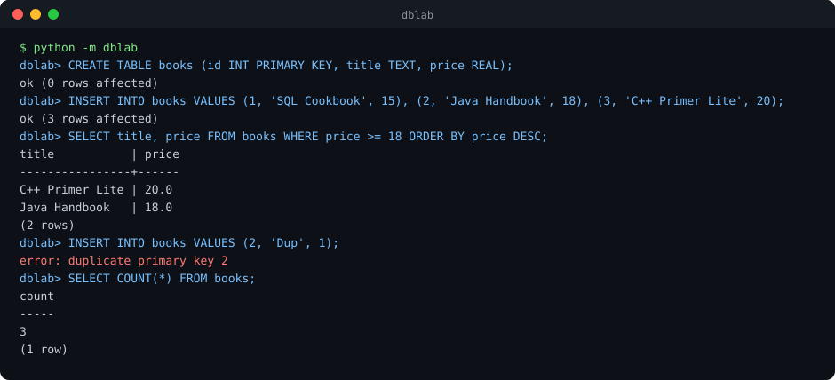

<div align="center">

# DBLab

**Learn databases by building one, in Python, Java, C++ and SQL.**<br>
A SQL engine with a write-ahead log, sharding, two-phase commit and 15 SQL exercises. Every idea is small enough to read in one sitting and covered by tests.

[](https://github.com/Sagar-Shahi/dblab/actions/workflows/ci.yml)


[](LICENSE)



</div>

## What you get

| Topic | What is inside | Languages |
|-------|----------------|-----------|
| **SQL** | A practice shop database and 15 graded exercises (joins, CTEs, window functions) with tested solutions | SQL |
| **DBMS** | A mini SQL engine with a write-ahead log, plus ACID and index demos | Python, SQL |
| **DDM** (distributed databases) | Consistent-hash sharding, quorum replication, two-phase commit | Python, Java, C++ |
| **Core data structures** | Consistent hash ring and LRU cache, written idiomatically in each language | Python, Java, C++ |

No dependencies: a Python, JDK or C++ compiler is all you need.

## Try it in 60 seconds

```bash
git clone https://github.com/Sagar-Shahi/dblab.git && cd dblab
make test        # runs the Python, SQL, Java and C++ test-suites
make shell       # opens the interactive SQL shell shown above
```

Run one language at a time with `make python`, `make java` or `make cpp`.

> [!TIP]
> New to databases? Start with the [DBMS guide](docs/dbms.md), then try the [SQL exercises](sql/exercises.md) before opening the solutions.

## Highlights

- **A real write-ahead log.** Every successful write is appended and fsync'd, and the log is replayed on open, so a restart rebuilds the exact same state.
- **Claims are tested, not just stated.** Adding a fifth node to a four-node hash ring moves under 30% of 5,000 keys (ideal 20%, plain `hash % n` moves about 80%), and every moved key lands on the new node.
- **The same ideas in three languages.** Compare the hash ring and LRU cache in [Python](python/dblab/sharding.py), [Java](java/src/dblab/HashRing.java) and [C++](cpp/hash_ring.hpp).
- **15 SQL exercises with checked answers.** CI runs every reference solution against the seed data.

<details>
<summary><b>The SQL engine from Python, with durability</b></summary>

Every successful write goes to a log that is replayed on the next open:

```python
from dblab import Database

db = Database("shop.wal")
db.execute("CREATE TABLE t (id INT PRIMARY KEY, name TEXT)")
db.execute("INSERT INTO t VALUES (1, 'asha'), (2, 'bikram')")

db = Database("shop.wal")                # a "restart": state is rebuilt from the log
print(db.execute("SELECT * FROM t"))     # [{'id': 1, 'name': 'asha'}, {'id': 2, 'name': 'bikram'}]
```

The engine supports `CREATE TABLE`, `INSERT`, `SELECT` (with `WHERE`, `ORDER BY`, `LIMIT`, `COUNT(*)`), `UPDATE`,
`DELETE` and `DROP TABLE`, with type checking, primary-key enforcement and all-or-nothing multi-row inserts.

</details>

<details>
<summary><b>Distributed building blocks: sharding, replication and two-phase commit</b></summary>

```python
from dblab import ShardedStore, Coordinator, Participant

store = ShardedStore(["a", "b", "c", "d", "e"], replicas=3)
store.put("user:42", {"name": "Asha"})
store.fail("a")                          # one node dies...
store.get("user:42")                     # ...reads still work
store.add_node("f")                      # scale out: only ~1/6 of the data moves

shards = [Participant("orders"), Participant("payments"), Participant("stock", will_commit=False)]
Coordinator(shards).run("txn-1")         # False: one "no" vote aborts everywhere
```

</details>

<details>
<summary><b>Repository layout</b></summary>

```
dblab/
├── python/
│   ├── dblab/           engine.py (SQL engine + WAL), sharding.py, twopc.py, repl.py
│   ├── examples/        acid_demo.py, index_demo.py
│   └── tests/           unittest suites, including the SQL exercise checker
├── java/src/dblab/      HashRing.java, LruCache.java, Tests.java
├── cpp/                 hash_ring.hpp, lru_cache.hpp, tests.cpp
├── sql/                 schema.sql, seed.sql, exercises.md, solutions.sql, expected.json
├── docs/                dbms.md (ACID, normalization, indexes, isolation), ddm.md (sharding, CAP, 2PC)
└── .github/workflows/   CI for all three languages
```

</details>

## Learning path

1. **Read** the [DBMS guide](docs/dbms.md), then from the `python/` folder run `python examples/acid_demo.py` and `python examples/index_demo.py`.
2. **Practice** the 15 problems in [sql/exercises.md](sql/exercises.md) before you look at the solutions.
3. **Read** [`python/dblab/engine.py`](python/dblab/engine.py) top to bottom. It is under 500 lines.
4. **Study** the [distributed databases guide](docs/ddm.md), then compare the hash ring in the three languages.
5. **Extend** the project with something from the roadmap below.

<details>
<summary><b>Roadmap and good first issues</b></summary>

- [ ] `JOIN` and `GROUP BY` in the SQL engine
- [ ] Secondary indexes (a B-tree) and a tiny query planner
- [ ] WAL checkpointing and crash-recovery tests
- [ ] Raft leader election across in-process nodes
- [ ] Ports of the ring and cache to Rust, Go and TypeScript
- [ ] MVCC snapshot isolation demo

</details>

## Contributing

Pull requests are welcome, especially new exercises and language ports. See [CONTRIBUTING.md](CONTRIBUTING.md) and the [issue tracker](https://github.com/Sagar-Shahi/dblab/issues).

## License

[MIT](LICENSE)
